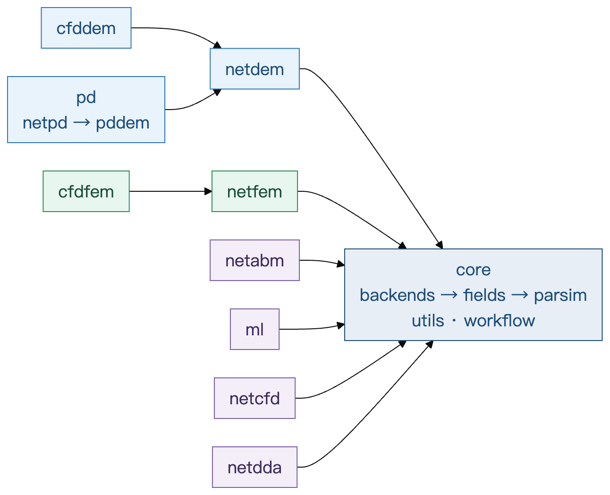

An arrow points at the pack that is required. The graph is a DAG: packs do not depend on each other in a cycle, so a license can download one branch without pulling another.

`core` is on every grant. The other packs are sold separately. `cfddem` and `pd` both require `netdem`. `cfdfem` requires `netfem`. `netcfd`, `netdda`, `netabm`, `ml`, and `netfem` require `core`.

The source file in the engine repository is `docs/dev/module-graph.json`. Packaging reads that file. The same picture is on the download server: [module-graph.png](https://download.xiaohe.team/phynexis-v1/module-graph.png).

